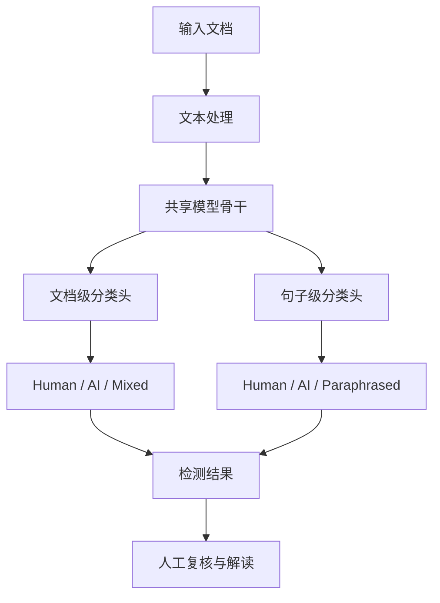

# Lynote AI Text Detector：AI 文本检测器

<p align="center">
  
</p>

<p align="center">
  <a href="https://github.com/lynote-ai/ai-text-detector/actions/workflows/ci.yml"></a>
  
  
</p>

<p align="center">
  <strong>支持文档级与句子级分析的 AI 生成文本检测项目</strong>
  <br />
  分析文本写作特征，定位可能由 AI 生成的句子，并识别人工撰写、AI 生成或混合内容。
</p>

<p align="center">
  <a href="./README.md">English</a>
  ·
  <a href="#核心功能">核心功能</a>
  ·
  <a href="#检测原理">检测原理</a>
  ·
  <a href="#使用场景">使用场景</a>
  ·
  <a href="#安装与使用">安装与使用</a>
</p>

Lynote AI Text Detector 是一个用于检测 AI 生成文本的开源项目，可分析论文、文章、学术写作、笔记、转录文本及其他书面内容。项目中的生产级模型支持两个层面的文本分析：整篇文档和文档中的单个句子。

与简单地将整篇文章判定为“人工撰写”或“AI 生成”的二分类方式不同，生产级模型支持文档级的 **Human（人工撰写）**、**AI（AI 生成）** 和 **Mixed（混合内容）** 分类，同时支持句子级的 **Human**、**AI** 和 **Paraphrased（改写内容）** 分类。

仓库还包含一个独立的轻量级本地分析器，用于可解释的离线文本风险初筛。本地分析器与生产级两级模型是不同的组件，二者的功能和评测结果不能混为一谈。

## 核心功能

### 1. 文档级 AI 文本检测

分析整篇文档的写作特征，并对整体内容进行分类。生产级模型支持：

- **Human**：判定为人工撰写。
- **AI**：判定为 AI 生成。
- **Mixed**：包含不同写作特征的混合内容。

通过文档级分析，用户可以了解整篇文本的整体检测结果，而不只是查看孤立的句子。

### 2. 句子级 AI 检测

不局限于整篇文章的单一检测结果。生产级模型还支持对文档中的单个句子进行分类：

- **Human**：人工撰写特征。
- **AI**：AI 生成特征。
- **Paraphrased**：改写特征。

句子级结果可以帮助审核者定位需要进一步检查的具体段落。但这些结果属于模型分类，并不能证明某句话的实际作者身份。

### 3. 混合内容检测

真实写作内容不一定完全由人类或 AI 单独完成。一篇文章可能同时包含人工原创内容、AI 生成段落，以及经过编辑或改写的内容。

生产级模型提供 `mixed` 文档类别，用于表达这种混合写作情况，而不是强制将每篇文档归入单一的人工或 AI 类别。

### 4. 可解释的本地文本分析

轻量级本地分析器会输出 AI 写作风险估计及相关解释信息：

- 0–100 的风险分数。
- 检测结论和置信度。
- 最主要的加权检测信号。
- 结果注意事项和局限性。
- 必要时提供后续建议。

本地分析器主要用于谨慎的初步筛查，并不是生产级两级分类模型。

### 5. 多语言模型开发

生产级检测管线采用多语言模型骨干，包括 XLM-R 和 ModernBERT。当前项目文档描述的重点语言包括英语、中文、葡萄牙语和西班牙语。

### 6. 负责任地解读检测结果

AI 文本检测本身存在不确定性。检测结果应当作为进一步审核的参考，而不是作者身份、学术违规或主观意图的确定性证据。对于短文本和高风险决策，需要格外谨慎。

## 检测原理

生产级检测管线采用共享模型骨干，并设置两个分类头：

1. **文档级分类头**：预测整篇文档的类别，即 `human`、`ai` 或 `mixed`。
2. **句子级分类头**：预测单个句子的类别，即 `human`、`ai` 或 `paraphrased`。

联合训练目标结合了文档级和句子级学习：

`L = L_doc + α · L_sent`



仓库同时包含生产级模型管线和轻量级本地分析器。两者的区别可参考[项目结构](#项目结构)及相关技术文档。

### 生产级模型技术文档

- [模型架构](detection-model-pipeline/docs/ARCHITECTURE.md)
- [模型方法](detection-model-pipeline/docs/MODEL.md)
- [数据构建](detection-model-pipeline/docs/DATA_CONSTRUCTION.md)
- [API 实现说明](detection-model-pipeline/docs/API.md)

## 使用场景

### 教师初步审核

教师收到学生提交的论文或课程反思，希望在进一步审核前获得初步检测参考。

建议流程：

1. 使用检测器分析提交的文本。
2. 查看可用的文档级结果，以及模型支持时提供的句子级分类。
3. 结合学生以往的写作样本和其他相关背景综合判断。

检测结果不能单独作为认定学术不端的证据。

### 编辑内容审核

编辑希望检查文章、产品描述、投稿内容或其他提交的文本，判断其中是否存在值得进一步关注的写作特征。

适用原因：

- 相比非常短的文本片段，较长的文章能够提供更多分析上下文。
- 可解释的检测信号可以帮助编辑定位需要检查的段落。
- 最终仍需要由人工进行编辑判断。

### 内容安全审核队列

内容审核团队希望将可疑的长文本优先分配到人工审核队列，而不是直接自动删除。

适用原因：

- 检测信号可以辅助安排审核优先级。
- 文档级和句子级结果可以从不同层面呈现同一篇文本。
- 最终内容审核决定仍应由人工做出。

### 内部内容质量审核

团队希望检查人工撰写和 AI 辅助生成的草稿，并识别可能需要进一步编辑的段落。

适用原因：

- 检测结果可以作为内容审核过程中的一项参考信号。
- 句子级分析有助于定位需要进一步检查的具体内容。
- 应结合实际上下文解读检测结果，而不能将其视为确定作者身份的结论。

## 检测结果：两个不同的组件

本仓库包含两个不同的检测组件，二者的输出不能视为完全相同。

### 生产级两级模型

生产级模型管线设计为提供以下结果：

| 分析层级 | 支持的分类 |
|---|---|
| 文档级 | `human`、`ai`、`mixed` |
| 句子级 | `human`、`ai`、`paraphrased` |

模型管线包含数据准备、模型训练、概率校准、评估和服务部署相关代码。当前仓库文档没有提供可泛化的生产模型准确率声明。

### 轻量级本地分析器

本地分析器提供独立的 AI 写作风险估计和证据信号。其检测结论包括：

- `insufficient_text`
- `low_ai_likelihood`
- `mixed_or_uncertain`
- `high_ai_likelihood`

示例输出：

```text
Conclusion: AI-like signals are present, but this medium-confidence score is a risk estimate rather than proof.

Score: 84/100
Confidence: medium
Verdict: high_ai_likelihood
Words analyzed: 256
```

该示例仅展示本地分析器的输出格式，不代表实际准确率，也不是生产级模型的输出示例。

## 安装与使用

轻量级本地分析器可以通过 Python 安装和运行。

### 环境要求

- Python 3.9 或更高版本。

### 安装

```bash
git clone https://github.com/lynote-ai/ai-text-detector.git
cd ai-text-detector
pip install -e .
```

也可以使用初始化脚本：

```bash
bash scripts/setup.sh
```

### 运行 AI 文本检测

检测文本文件：

```bash
ai-detect examples/sample_ai_like.txt
```

输出 JSON 格式：

```bash
ai-detect examples/sample_ai_like.txt --json
```

通过标准输入读取文本：

```bash
cat essay.txt | ai-detect --json
```

## Python 使用方式

也可以直接在 Python 项目中调用轻量级本地分析器：

```python
from aidetect import analyze_text

with open("essay.txt", encoding="utf-8") as file:
    text = file.read()

result = analyze_text(text)

print("Score:", result.score)
print("Confidence:", result.confidence)
print("Verdict:", result.verdict)

for signal in result.strongest_signals():
    print(signal.name, signal.note)
```

## 数据集评测

仓库使用公开的 [HC3 数据集](https://huggingface.co/datasets/Hello-SimpleAI/HC3)，对**轻量级本地分析器**进行可复现评测。

文档记录的评测使用英文 `finance`、`medicine` 和 `open_qa` 三个子集，每个子集取前 100 条数据。

### 评测结果摘要

| 指标 | 结果 |
|---|---:|
| Human 平均分数 | 5.4 |
| AI 平均分数 | 18.4 |
| 平均分数差异 | 13.0 points |
| Human Coverage | 0.427 |
| AI Coverage | 0.920 |
| Covered Accuracy（score ≥ 45） | 0.317 |

这组结果表明，在该样本中，本地分析器对人工文本和 AI 文本的平均分数存在一定区分，但测得的覆盖样本准确率仍然有限。因此，更适合将它理解为一个谨慎的初筛和解释工具，而不是独立的作者身份分类器。

**评测范围说明：** 以上指标仅适用于文档所述 HC3 样本中的轻量级本地分析器，不代表生产级两级模型的评测结果。

查看[完整 HC3 评测报告](docs/HC3_EVALUATION.md)。

复现评测：

```bash
make eval-hc3
```

## 项目结构

```text
ai-text-detector/
├── detection-model-pipeline/   # 生产级两级模型管线
│   ├── code/                   # 流程阶段及校验器
│   ├── model_entity/           # 模型组件与骨干网络
│   ├── data/demos/             # 合成演示数据
│   └── docs/                   # 模型与管线文档
├── assets/                     # 项目图片与示意图
├── docs/                       # 评测报告
├── examples/                   # 示例输入文本
├── references/                 # 参考文档
├── scripts/                    # 本地检测与评测脚本
├── src/aidetect/               # 轻量级本地分析器
├── tests/                      # 测试
├── AGENTS.md
├── SKILL.md
├── README.md
├── README.zh-CN.md
├── pyproject.toml
└── requirements.txt
```

## 开发者集成

本项目的核心定位是 AI 生成文本检测。对于本地使用，仓库通过轻量级分析器提供 CLI 和 Python 调用方式。

如果需要通过托管服务将检测能力集成到其他应用，可以查看可选的 [Lynote AI Detector API](https://lynote.ai/ai-detector-api)。API 是额外的集成方式，而不是本仓库的核心定位。

技术参考：

- [模型管线 API 文档](detection-model-pipeline/docs/API.md)
- [本地分析器参考文档](references/api-reference.md)

## 开发命令

运行测试：

```bash
make test
```

运行演示：

```bash
make demo
```

运行基准测试：

```bash
make benchmark
```

运行 HC3 评测：

```bash
make eval-hc3
```

### 持续集成

GitHub Actions 配置为在 Python 3.9、3.11 和 3.13 环境下运行测试，重新生成基准测试和 HC3 评测报告，并将报告作为 workflow artifacts 上传。

## 参与贡献

欢迎参与项目贡献。以下方向尤其有价值：

- 文档级与句子级 AI 文本检测。
- 多语言检测能力。
- 可解释的检测信号。
- 评测方法与基准数据覆盖。
- 负责任的结果解读与用户指引。

贡献指南请参阅 [CONTRIBUTING.md](CONTRIBUTING.md)。

## 相关项目

- [Lynote AI Humanize Text](https://github.com/lynote-ai/humanize-text)
- [Lynote AI Image Detector](https://github.com/lynote-ai/ai-image-detector)
- [Lynote](https://lynote.ai/)

## 许可证

本项目采用 MIT License，详情请查看 [LICENSE](LICENSE)。

---

<p align="center">
  <strong>Lynote AI Text Detector</strong>
  <br />
  在文档级与句子级识别 AI 生成文本。
</p>
