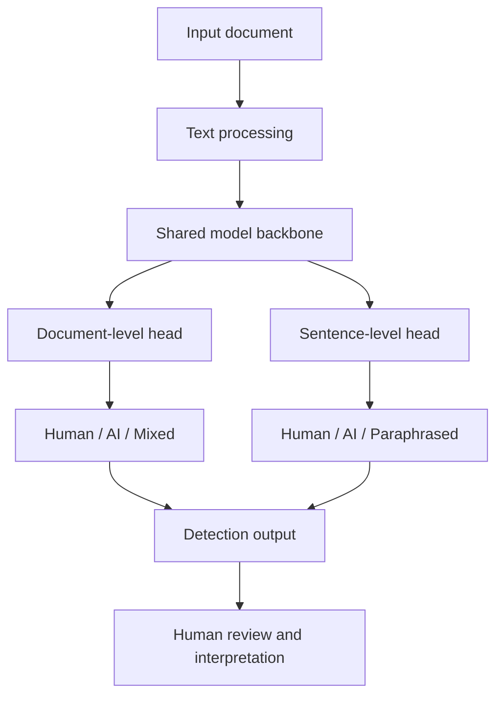

# Lynote AI Text Detector

<p align="center">
  
</p>

<p align="center">
  <a href="https://github.com/lynote-ai/ai-text-detector/actions/workflows/ci.yml"></a>
  
  
</p>

<p align="center">
  <strong>Detect AI-Generated Text at Document and Sentence Levels</strong>
  <br />
  Analyze writing patterns, identify potentially AI-generated sentences, and review content classified as human-written, AI-generated, or mixed.
</p>

<p align="center">
  <a href="./README.zh-CN.md">简体中文</a>
  ·
  <a href="#features">Features</a>
  ·
  <a href="#how-it-works">How It Works</a>
  ·
  <a href="#use-cases">Use Cases</a>
  ·
  <a href="#installation">Installation</a>
</p>

Lynote AI Text Detector is an AI-generated text detection project for analyzing essays, articles, academic writing, notes, transcripts, and other written content. Its production model is designed to examine text at two levels: the overall document and individual sentences.

Rather than treating every document as entirely human-written or entirely AI-generated, the production model supports **Human**, **AI**, and **Mixed** document classifications, alongside sentence-level **Human**, **AI**, and **Paraphrased** classifications.

The repository also includes a separate lightweight local analyzer for explainable, offline text-risk triage. The local analyzer and the production two-level model are different components; their capabilities and evaluation results should not be conflated.

## Features

### Document-Level AI Text Detection

Analyze a complete document and classify its overall writing patterns. The production model supports:

- **Human** — classified as human-written.
- **AI** — classified as AI-generated.
- **Mixed** — a document containing a combination of writing patterns.

### Sentence-Level AI Detection

Go beyond a single document-level result. The production model also classifies individual sentences as:

- **Human**
- **AI**
- **Paraphrased**

Sentence-level results can help reviewers locate sections that warrant closer attention. They should be interpreted as model classifications, not proof of who wrote a sentence.

### Mixed-Content Analysis

Real-world writing may combine original human writing, AI-generated passages, and edited or paraphrased material. The production model includes a `mixed` document class to represent this kind of content rather than forcing every document into a binary human-or-AI label.

### Explainable Local Analysis

The lightweight local analyzer returns an AI-like writing risk estimate with supporting information:

- Risk score from 0 to 100.
- Verdict and confidence level.
- Strongest weighted signals.
- Caveats and limitations.
- Suggested next steps when useful.

This local analyzer is intended for cautious preliminary review. It is not the production two-level classifier.

### Multilingual Model Development

The production pipeline is designed around multilingual backbones, including XLM-R and ModernBERT, with the current project documentation describing work focused on English, Chinese, Portuguese, and Spanish.

### Responsible Interpretation

AI-text detection is inherently uncertain. Results should be treated as indicators for review, not definitive proof of authorship, misconduct, or intent. Short samples and high-stakes decisions require particular caution.

## How It Works

The production detection pipeline uses a shared model backbone with two classification heads:

1. **Document head** — predicts a document-level class: `human`, `ai`, or `mixed`.
2. **Sentence head** — predicts sentence-level classes: `human`, `ai`, or `paraphrased`.

The joint training objective combines document-level and sentence-level learning:

`L = L_doc + α · L_sent`



The repository contains both the production model pipeline and a lightweight local analyzer. See the [project structure](#project-structure) and the technical documentation for the distinction.

### Production Model Documentation

- [Architecture](detection-model-pipeline/docs/ARCHITECTURE.md)
- [Model methodology](detection-model-pipeline/docs/MODEL.md)
- [Data construction](detection-model-pipeline/docs/DATA_CONSTRUCTION.md)
- [API implementation notes](detection-model-pipeline/docs/API.md)

## Use Cases

### Teacher Triage

A teacher receives a student essay or reflection and wants an initial signal before conducting a closer review.

Suggested workflow:

1. Run the detector on the submitted text.
2. Review the available document-level result and, where supported, sentence-level classifications.
3. Consider the result alongside the student's previous writing and other relevant context.

Detection results should never be treated as proof of academic misconduct.

### Editorial Review

An editor wants to review articles, product descriptions, guest posts, or other submitted content for writing patterns that may deserve closer attention.

Why it fits:

- Longer-form prose provides more context for review than very short snippets.
- Explainable signals can help editors decide which passages to examine.
- Human editorial judgment remains essential.

### Trust and Safety Queueing

A moderation team wants to prioritize suspicious long-form posts for manual review rather than automatically removing content.

Why it fits:

- Detection signals can support review prioritization.
- Document-level and sentence-level results can provide different views of the same text.
- Final moderation decisions remain with human reviewers.

### Internal Content Quality Review

A team wants to review human-written and AI-assisted drafts and identify passages that may need additional editing.

Why it fits:

- Detection results can be used as one signal during content review.
- Sentence-level analysis can help locate specific passages for closer examination.
- Results should be interpreted in context, not as definitive authorship claims.

## Detection Results: Two Different Components

This repository includes two distinct detection components. Their outputs should not be treated as interchangeable.

### Production Two-Level Model

The production pipeline is designed to provide:

| Analysis level | Supported classifications |
|---|---|
| Document | `human`, `ai`, `mixed` |
| Sentence | `human`, `ai`, `paraphrased` |

The pipeline includes data preparation, training, calibration, evaluation, and serving code. The repository documentation does not make a general production-accuracy claim.

### Lightweight Local Analyzer

The local analyzer provides a separate risk estimate and evidence signals. Its verdict values are:

- `insufficient_text`
- `low_ai_likelihood`
- `mixed_or_uncertain`
- `high_ai_likelihood`

Example output:

```text
Conclusion: AI-like signals are present, but this medium-confidence score is a risk estimate rather than proof.

Score: 84/100
Confidence: medium
Verdict: high_ai_likelihood
Words analyzed: 256
```

The example illustrates the local analyzer's output format; it is not a claim about expected accuracy or production-model output.

## Installation

The lightweight local analyzer can be installed and run with Python.

### Requirements

- Python 3.9 or later.

### Install

```bash
git clone https://github.com/lynote-ai/ai-text-detector.git
cd ai-text-detector
pip install -e .
```

Alternatively, initialize a local environment with:

```bash
bash scripts/setup.sh
```

### Run Detection

Analyze a text file:

```bash
ai-detect examples/sample_ai_like.txt
```

Return JSON:

```bash
ai-detect examples/sample_ai_like.txt --json
```

Read text from standard input:

```bash
cat essay.txt | ai-detect --json
```

## Python Usage

The lightweight local analyzer can also be called from Python:

```python
from aidetect import analyze_text

with open("essay.txt", encoding="utf-8") as file:
    text = file.read()

result = analyze_text(text)

print("Score:", result.score)
print("Confidence:", result.confidence)
print("Verdict:", result.verdict)

for signal in result.strongest_signals():
    print(signal.name, signal.note)
```

## Evaluation

The repository includes a reproducible evaluation of the **lightweight local analyzer** using the public [HC3 dataset](https://huggingface.co/datasets/Hello-SimpleAI/HC3).

The documented evaluation uses the English `finance`, `medicine`, and `open_qa` subsets, taking the first 100 rows from each subset.

### Evaluation Snapshot

| Metric | Result |
|---|---:|
| Human mean score | 5.4 |
| AI mean score | 18.4 |
| Mean separation | 13.0 points |
| Human coverage | 0.427 |
| AI coverage | 0.920 |
| Covered accuracy at `score >= 45` | 0.317 |

These results indicate that the local analyzer separates human and AI answers on average in this sample, but its measured covered accuracy is limited. It is better understood as a cautious triage and explanation tool than as a stand-alone authorship classifier.

**Scope note:** These metrics apply only to the lightweight local analyzer on the documented HC3 sample. They are not benchmark results for the production two-level model.

Read the [full HC3 evaluation report](docs/HC3_EVALUATION.md).

Reproduce the evaluation:

```bash
make eval-hc3
```

## Project Structure

```text
ai-text-detector/
├── detection-model-pipeline/   # Production two-level model pipeline
│   ├── code/                   # Pipeline stages and validators
│   ├── model_entity/           # Model components and backbones
│   ├── data/demos/             # Synthetic demo data
│   └── docs/                   # Model and pipeline documentation
├── assets/                     # Project images and diagrams
├── docs/                       # Evaluation reports
├── examples/                   # Example input text
├── references/                 # Reference documentation
├── scripts/                    # Local detection and evaluation scripts
├── src/aidetect/               # Lightweight local analyzer
├── tests/                      # Tests
├── AGENTS.md
├── SKILL.md
├── README.md
├── README.zh-CN.md
├── pyproject.toml
└── requirements.txt
```

## Developer Integration

The primary focus of this project is AI-generated text detection. For local use, the repository provides a CLI and Python interface through the lightweight analyzer.

For hosted integration into another application, see the optional [Lynote AI Detector API](https://lynote.ai/ai-detector-api). API access is an additional integration option, not the central purpose of this repository.

Technical references:

- [Pipeline API documentation](detection-model-pipeline/docs/API.md)
- [Local reference documentation](references/api-reference.md)

## Development

Run the test suite:

```bash
make test
```

Run the demo:

```bash
make demo
```

Run the benchmark:

```bash
make benchmark
```

Run the HC3 evaluation:

```bash
make eval-hc3
```

### Continuous Integration

GitHub Actions is configured to run tests on Python 3.9, 3.11, and 3.13, regenerate benchmark and HC3 evaluation reports, and upload the reports as workflow artifacts.

## Contributing

Contributions are welcome. Useful areas include:

- Document-level and sentence-level detection.
- Multilingual detection.
- Explainable detection signals.
- Evaluation methodology and benchmark coverage.
- Responsible interpretation and safer user guidance.

See [CONTRIBUTING.md](CONTRIBUTING.md) for contribution guidelines.

## Related Projects

- [AI Humanize Text](https://github.com/lynote-ai/humanize-text)
- [AI Image Detector](https://github.com/lynote-ai/ai-image-detector)
- [AI Tutor](https://github.com/lynote-ai/ai-tutor)

## License

MIT. See [LICENSE](LICENSE) for details.

---

<p align="center">
  <strong>Lynote AI Text Detector</strong>
  <br />
  AI-generated text detection at document and sentence levels.
</p>
